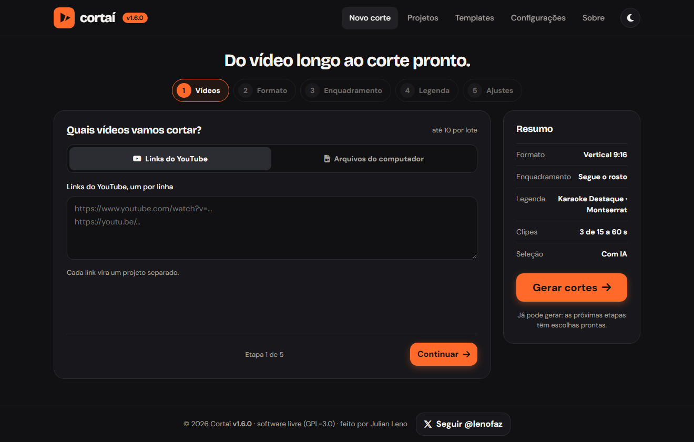
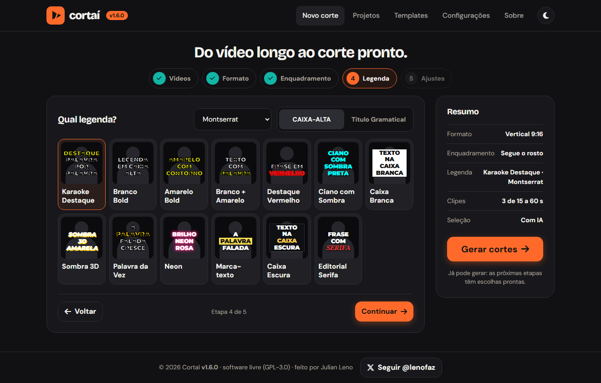
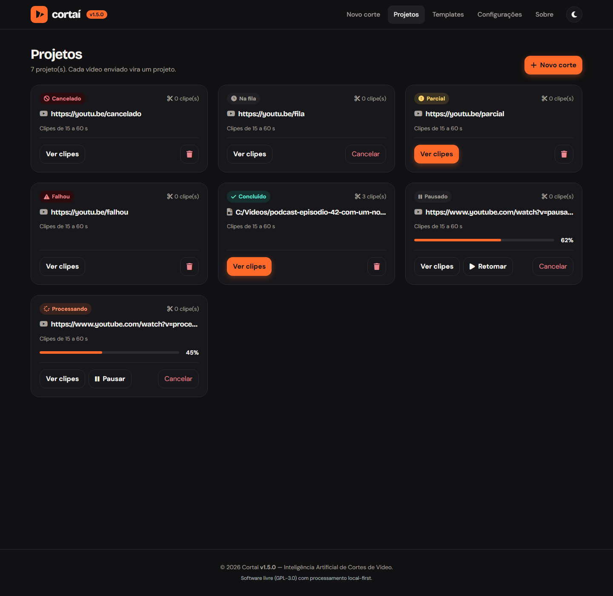
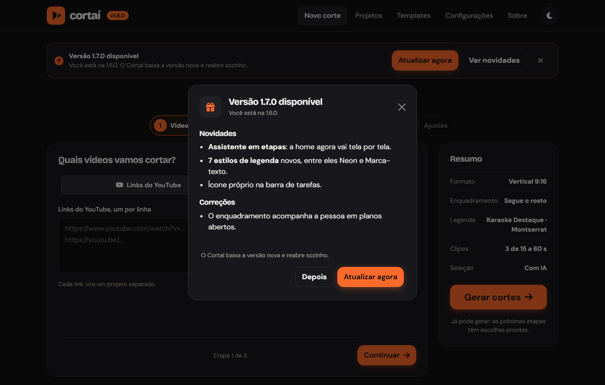

<p align="center">
  
</p>

# ✂️ Cortaí

Transforme vídeos longos em clipes verticais (9:16) e horizontais (16:9) legendados, prontos para Shorts, TikTok e Reels. O Cortaí roda no seu computador e é gratuito.

[](https://github.com/julianleno/cortai/releases)
[](LICENSE)
[](https://github.com/julianleno/cortai/actions/workflows/tests.yml)

<p align="center">
  <a href="docs/screenshots/assistente-videos.png"></a>
  <a href="docs/screenshots/processando.png"></a>
</p>

**Neste README:** [Baixe e use](#baixe-e-use-no-windows) · [Rodar pelo código](#rodar-pelo-código-fonte) · [Como usar](#como-usar) · [Funcionalidades](#funcionalidades) · [IA e privacidade](#ia-e-privacidade) · [Configuração](#configuração) · [Problemas comuns](#problemas-comuns) · [Contribuindo](#contribuindo)

## Baixe e use no Windows

Você não precisa instalar o Python nem saber programar.

1. Baixe o `Cortai.exe` na página de [Releases](https://github.com/julianleno/cortai/releases/latest).
2. Salve o arquivo numa pasta só dele, por exemplo `Documentos\Cortai`. O Cortaí guarda os clipes e o banco de dados nessa pasta.
3. Dê duplo clique no `Cortai.exe`. O Cortaí abre numa janela própria, sem navegador.

O `Cortai.exe` não tem assinatura digital, então o Windows SmartScreen mostra o aviso "O Windows protegeu o computador". Para abrir mesmo assim, clique em **Mais informações** e depois em **Executar assim mesmo**.

## Rodar pelo código-fonte

Use este caminho no Linux, no macOS ou se você quer mexer no código.

### Pré-requisitos

| Requisito | Para que serve | Como instalar |
|---|---|---|
| **Python 3.12+** | Executa o Cortaí | **Windows**: [python.org](https://www.python.org/downloads/) (marque "Add python.exe to PATH"). **Ubuntu/Debian**: `sudo apt install python3 python3-venv`. **macOS**: `brew install python@3.12` |
| **FFmpeg** (com `ffprobe`) | Processa vídeo e áudio | **Windows**: build "full" em [gyan.dev/ffmpeg/builds](https://www.gyan.dev/ffmpeg/builds/), com a pasta `bin` no PATH. **Ubuntu/Debian**: `sudo apt install ffmpeg`. **macOS**: `brew install ffmpeg` |
| **Deno** (opcional) | Remove o aviso "No supported JavaScript runtime" do yt-dlp ao baixar do YouTube | **Windows**: `winget install DenoLand.Deno`. **macOS**: `brew install deno`. Outros: [deno.com](https://deno.com/) |
| **uv** (opcional) | Cria o ambiente e instala as dependências mais rápido | [docs.astral.sh/uv](https://docs.astral.sh/uv/) |

Sem o Deno, o download do YouTube funciona, mas alguns formatos podem faltar ([issue #6](https://github.com/julianleno/cortai/issues/6)).

### Windows

```powershell
git clone https://github.com/julianleno/cortai.git
cd cortai
```

Depois, dê duplo clique em **`start.bat`**. O Cortaí abre numa janela própria. Para usar o navegador, defina `CORTAI_JANELA=0` e abra **http://127.0.0.1:5000**.

### Linux e macOS

```bash
git clone https://github.com/julianleno/cortai.git
cd cortai
./start.sh
```

Depois, abra **http://127.0.0.1:5000** no navegador. Se aparecer `Permission denied`, rode `bash start.sh`.

### O que os inicializadores fazem

`start.bat`, `start.ps1` e `start.sh` seguem os mesmos passos:

1. Conferem o Python, o FFmpeg e o `ffprobe`, e mostram como instalar o que falta.
2. Copiam `.env.example` para `.env`, se o `.env` não existe.
3. Criam o ambiente virtual `.venv` e instalam o Cortaí nele.
4. Conferem se a porta do `FLASK_PORT` (padrão `5000`) está livre.
5. Iniciam o Cortaí.

Nas próximas vezes, rode o mesmo inicializador para abrir o Cortaí.

## Primeira abertura

Na primeira vez, o Cortaí mostra a tela **Preparando o Cortaí**. Ela confere se o FFmpeg está instalado e, no Windows, oferece instalar uma versão portátil na pasta do app com um clique. Depois, ela baixa o modelo de transcrição do Whisper e mostra uma barra de progresso.

## Como usar

A tela **Novo corte** é um assistente de 5 etapas. O resumo ao lado mostra suas escolhas, e o botão **Gerar cortes** funciona em qualquer etapa: as etapas seguintes já vêm com escolhas prontas.

1. **Vídeos**: cole até 10 links do YouTube, um por linha. Ou envie vários arquivos `.mp4`, `.mkv`, `.mov`, `.avi` e `.webm`. Se tiver um template do canal, escolha aqui.
2. **Formato**: **Vertical 9:16** (até 60 s) ou **Horizontal 16:9** (até 5 min).
3. **Enquadramento**: escolha como o Cortaí posiciona a pessoa no quadro.
4. **Legenda**: escolha o estilo, a fonte e a capitalização.
5. **Ajustes**: quantidade de clipes (1 a 10), duração mínima e máxima, idioma da fala e vocabulário.

<p align="center">
  <a href="docs/screenshots/assistente-legenda.png"></a>
</p>

Cada vídeo vira um projeto. A tela **Projetos** mostra o andamento de todos, com **Pausar**, **Retomar** e **Cancelar**.

<p align="center">
  <a href="docs/screenshots/projetos.png"></a>
</p>

Na página do projeto, cada clipe pronto tem estes botões:

- **Baixar**: salva o clipe no computador.
- **Reenquadrar**: move o corte 9:16 para a esquerda ou para a direita com um controle deslizante. O Cortaí gera só esse clipe de novo.
- **Legenda**: abre o editor. Corrija o texto palavra por palavra ou troque a fonte, e o Cortaí gera o clipe de novo.

Para repetir as mesmas escolhas em outros vídeos, crie um template na tela **Templates**. Um template guarda enquadramento, legenda, marca d'água e vocabulário.

## Funcionalidades

- **Vídeos em lote**: até 10 links do YouTube ou vários arquivos do computador por vez.
- **Escolha dos trechos**: uma IA na nuvem (Gemini, OpenAI, Anthropic ou NVIDIA NIM) ou o motor local, sem nuvem. Cada clipe recebe nota, título e gancho, que você copia com um clique.
- **Formatos**: vertical 9:16 (até 60 s) ou horizontal 16:9 (até 5 min).
- **6 enquadramentos**: *Segue o rosto* (enquadra cada cena e acompanha quem anda), *Ativo por fala* (troca de rosto pela voz e pelo movimento dos lábios), *Card social*, *Editorial* (título no topo, marca embaixo), *Fundo desfocado* e *Crop central*.
- **13 estilos de legenda**: Karaoke Destaque, Branco Bold, Amarelo Bold, Branco + Amarelo, Destaque Vermelho, Ciano com Sombra, Caixa Branca, Sombra 3D, Palavra da Vez, Neon, Marca-texto, Caixa Escura e Editorial Serifa.
- **9 fontes**: Arial, Montserrat, Impact, Anton, Bebas Neue, Poppins, Inter, Outfit e Roboto.
- **Capitalização**: CAIXA-ALTA ou Título Gramatical (conectivos como `de`, `da` e `para` ficam em minúsculas).
- **Vocabulário**: informe nomes e siglas, por exemplo `ANAC, VOEPASS`, e a legenda corrige o que a transcrição errar.
- **Editor de legenda**: corrija palavra por palavra e gere o clipe de novo.
- **Reenquadrar**: ajuste a posição do corte 9:16 sem processar o vídeo inteiro de novo.
- **Templates do canal**: enquadramento, legenda, marca d'água (posição e opacidade) e vocabulário salvos com um nome.
- **Controle do processamento**: progresso em 5 etapas (Download, Transcrição, Rosto ativo, Legenda e moldura, Exportação), com Pausar, Retomar e Cancelar.
- **Idioma da fala**: detecção automática, português, inglês ou espanhol.
- **Aviso de versão nova**: o Cortaí mostra as novidades e, no `Cortai.exe`, atualiza com um clique.

## IA e privacidade

### O que roda no seu computador

O download, a transcrição (faster-whisper), o enquadramento, a legenda e a exportação rodam no seu computador. Os vídeos nunca saem dele.

### O que vai para a nuvem

Sem chave de IA, nada vai para a nuvem: o motor local escolhe os trechos pela transcrição e pelo áudio.

Com uma chave, o Cortaí envia **só o texto da transcrição, com os tempos de cada trecho**, para o provedor escolhido. A IA devolve os trechos sugeridos.

| Provedor | Variável da chave | Modelo padrão |
|---|---|---|
| Google Gemini | `GEMINI_API_KEY` | `gemini-flash-latest` (mude com `GEMINI_MODEL`) |
| OpenAI | `OPENAI_API_KEY` | `gpt-4o-mini` |
| Anthropic | `ANTHROPIC_API_KEY` | `claude-haiku-5-5` |
| NVIDIA NIM | `NVIDIA_NIM_API_KEY` | `meta/llama-3.1-8b-instruct` (mude com `NVIDIA_NIM_MODEL`) |

Com mais de uma chave, o Cortaí tenta nesta ordem: Gemini, OpenAI, Anthropic e NVIDIA NIM. Se todos falham, ele usa o motor local.

### Checagem de atualização

Uma vez por dia, o Cortaí consulta a última release pública do Cortaí no GitHub. Nada seu é enviado nessa consulta. Quando há versão nova, ele mostra um aviso com as novidades. No `Cortai.exe`, o botão **Atualizar agora** baixa a versão nova e reabre o app. Pelo código-fonte, rode `git pull`. Para desligar a checagem, defina `CORTAI_CHECAR_ATUALIZACAO=0`.

<p align="center">
  <a href="docs/screenshots/versao-nova.png"></a>
</p>

## Configuração

### Tela Configurações

Na tela **Configurações** você define:

- **Chaves de API** dos provedores de IA. As chaves salvas ali têm prioridade sobre o `.env` e ficam só no seu computador.
- **Navegador de onde pegar os cookies**, usado quando o YouTube pede login. O modo Automático tenta Chrome, Edge, Firefox, Brave e Opera.

### Arquivo `.env`

O inicializador cria o `.env` a partir do `.env.example`. Para criar à mão, rode `cp .env.example .env` (no Windows: `copy .env.example .env`).

| Variável | Padrão | Para que serve |
|---|---|---|
| `GEMINI_API_KEY`, `OPENAI_API_KEY`, `ANTHROPIC_API_KEY`, `NVIDIA_NIM_API_KEY` | vazio | Chaves dos provedores de IA. Veja [IA e privacidade](#ia-e-privacidade). |
| `GEMINI_MODEL` / `NVIDIA_NIM_MODEL` | `gemini-flash-latest` / `meta/llama-3.1-8b-instruct` | Modelo de cada provedor. |
| `WHISPER_MODEL_SIZE` | `base` | Modelo de transcrição: `tiny`, `base`, `small`, `medium` ou `large-v3`. |
| `WHISPER_DEVICE` / `WHISPER_COMPUTE_TYPE` | `cpu` / `int8` | Com GPU NVIDIA, use `cuda` / `float16`. |
| `FFMPEG_THREADS` | `0` | Threads do FFmpeg. `0` deixa o FFmpeg decidir. |
| `YTDLP_FORMAT` / `YTDLP_OUTDIR` | MP4 / `./storage/downloads` | Formato e pasta dos downloads do YouTube. |
| `OUTPUT_DIR` / `TEMP_DIR` | `./storage/output` / `./storage/temp` | Pasta dos clipes e pasta dos arquivos temporários. |
| `DB_PATH` | `./storage/cortai.db` | Banco SQLite com projetos, clipes, templates e configurações. |
| `WATERMARK_IMAGE` | `./assets/watermark.png` | Imagem padrão da marca d'água dos templates. |
| `FLASK_HOST` / `FLASK_PORT` | `127.0.0.1` / `5000` | Endereço do servidor local. Mantenha `127.0.0.1` para não expor o Cortaí na rede. |
| `FLASK_DEBUG` | `False` | Modo de depuração do Flask. |
| `CORTAI_JANELA` | `1` | No Windows, `0` troca a janela própria pelo navegador. |
| `CORTAI_CHECAR_ATUALIZACAO` | `1` | `0` desliga a checagem de versão nova. |

## Problemas comuns

**"FFmpeg não encontrado"**
Instale o FFmpeg com o `ffprobe` e coloque a pasta `bin` no PATH (veja [Pré-requisitos](#pré-requisitos)). Depois, feche e abra o terminal e rode `ffmpeg -version` para conferir.

**O Windows bloqueia o `Cortai.exe`**
O SmartScreen avisa porque o executável não tem assinatura digital. Clique em **Mais informações** e depois em **Executar assim mesmo**.

**O primeiro clipe demora**
Na primeira transcrição, o Cortaí baixa o modelo do Whisper definido em `WHISPER_MODEL_SIZE`. As próximas transcrições usam o modelo já baixado.

**O YouTube pede login ou "Sign in to confirm you're not a bot"**
Entre no YouTube por um navegador do computador. Na tela **Configurações**, escolha esse navegador em **Navegador de onde pegar os cookies**.

**Os créditos da IA acabaram**
Quando o provedor falha, o Cortaí tenta o próximo provedor com chave e, por último, o motor local. Os clipes saem mesmo assim, escolhidos pelo motor local.

## Contribuindo

Contribuições são bem-vindas. Leia o [guia de contribuição](CONTRIBUTING.md) e o [Código de Conduta](CODE_OF_CONDUCT.md). Para relatar uma falha de segurança, siga o [SECURITY.md](SECURITY.md). As decisões de arquitetura estão em [DECISIONS.md](DECISIONS.md).

Para começar, escolha uma das [issues marcadas como good first issue](https://github.com/julianleno/cortai/issues?q=is%3Aissue+is%3Aopen+label%3A%22good+first+issue%22) (#3 a #7).

### Rodar os testes

O pytest fica em `[tool.uv] dev-dependencies` no `pyproject.toml`. Instale o pytest no `.venv` e rode a suíte:

```bash
# Linux/macOS
.venv/bin/python -m pip install pytest
.venv/bin/python -m pytest
```

```powershell
# Windows
.venv\Scripts\python -m pip install pytest
.venv\Scripts\python -m pytest
```

O `tests/conftest.py` usa um banco temporário, então os testes não mexem nos seus projetos. O GitHub Actions roda a mesma suíte, com FFmpeg, a cada push na `main` e em cada pull request.

### Gerar o `Cortai.exe`

No Windows, com o `.venv` ativo, rode:

```powershell
python build_exe.py
```

O script instala o PyInstaller, se faltar, e salva o executável em `dist\Cortai.exe`.

### Publicar uma release

1. Atualize `version` no `pyproject.toml` e `__version__` em `src/cortai/__init__.py`.
2. Gere o `Cortai.exe`.
3. Crie a release no GitHub com a tag `vX.Y.Z`, por exemplo `v1.7.0`.
4. Anexe o executável com o nome exato `Cortai.exe`. Sem esse arquivo, o botão **Atualizar agora** não funciona.
5. Publique a release. Rascunhos (draft) não aparecem para os usuários.

As notas da release viram o aviso de versão nova dentro do app. Escreva as notas em markdown simples: títulos `##`, listas com `-`, `**negrito**` e `` `código` ``. O aviso não mostra links, imagens nem tabelas.

## Histórico de versões

- **v1.6.1**
  - *Segue o rosto* enquadra cada cena: em vídeos com close e plano aberto, a pessoa fica no quadro o tempo todo, e o corte acompanha quem anda pelo palco.
  - O corte em trechos ficou exato no quadro (a legenda não escorrega) e cerca de 2x mais rápido.
- **v1.6.0**
  - Tela Novo corte em assistente de 5 etapas, com resumo ao lado.
  - Visual novo em todas as telas.
  - 7 estilos de legenda novos, entre eles Palavra da Vez, Marca-texto, Neon e Caixa Escura.
  - No Windows, abre numa janela própria, com ícone na barra de tarefas.
  - Aviso de versão nova com as novidades e atualização com um clique no `Cortai.exe`.
  - `start.sh` para Linux e macOS e `Cortai.exe` nas Releases.
  - Corrige a transcrição em instalações novas (PyAV 19) e troca o modelo padrão da Anthropic para `claude-haiku-5-5`.
  - Testes automáticos no GitHub Actions.
- **v1.5.0**
  - Vários vídeos por vez (links do YouTube e arquivos) e a tela Projetos.
  - Identidade visual Cortaí (marca, paleta Caju/Mar/Sol e tipografia, em [`docs/brand/`](docs/brand/)).
  - Vocabulário para corrigir nomes e siglas na legenda.
  - Pausar, Retomar e Cancelar.
  - Prévia dos clipes no app e Reenquadrar para o formato 9:16.
  - Formato horizontal 16:9 (até 5 min).
  - Enquadramento Ativo por fala, Card social e Editorial.
  - Capitalização Título Gramatical.
- **v1.0.0**: primeira versão, com clipes 9:16 de vídeos do YouTube e transcrição local com faster-whisper.

## Uso responsável

O Cortaí é uma ferramenta de edição. Você responde pelo conteúdo que processa. Use só vídeos que você tem direito de baixar, editar e publicar. Respeite os direitos autorais e os Termos de Serviço das plataformas, incluindo o YouTube.

## Créditos

O Cortaí usa estes projetos open source:

- [FFmpeg](https://ffmpeg.org/): processamento de vídeo e áudio
- [faster-whisper](https://github.com/SYSTRAN/faster-whisper): transcrição local
- [yt-dlp](https://github.com/yt-dlp/yt-dlp): download de vídeos
- [OpenCV](https://opencv.org/) e o modelo [YuNet](https://github.com/opencv/opencv_zoo/tree/main/models/face_detection_yunet) (licença MIT): detecção de rosto
- [Flask](https://flask.palletsprojects.com/): interface
- [pywebview](https://pywebview.flowrl.com/): janela própria no Windows

Criado por Julian Leno. Siga [@lenofaz no X](https://x.com/lenofaz).

## Licença

O Cortaí é distribuído sob a [GNU General Public License v3.0](LICENSE). Você pode usar, estudar, modificar e redistribuir o Cortaí, inclusive para fins comerciais. Versões modificadas que você distribuir também precisam ser abertas sob a GPL-3.0.

© 2026 Julian Leno e colaboradores do Cortaí.
