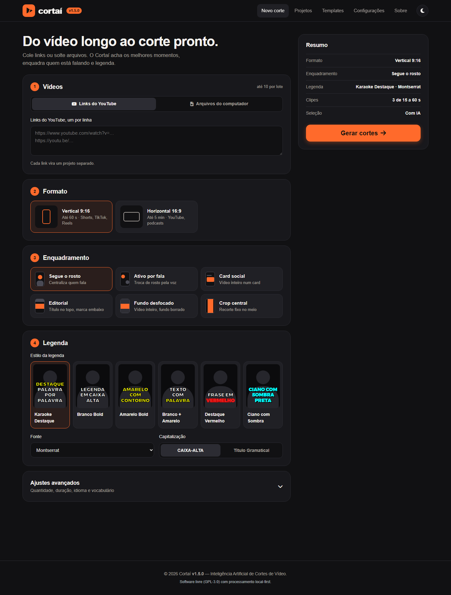
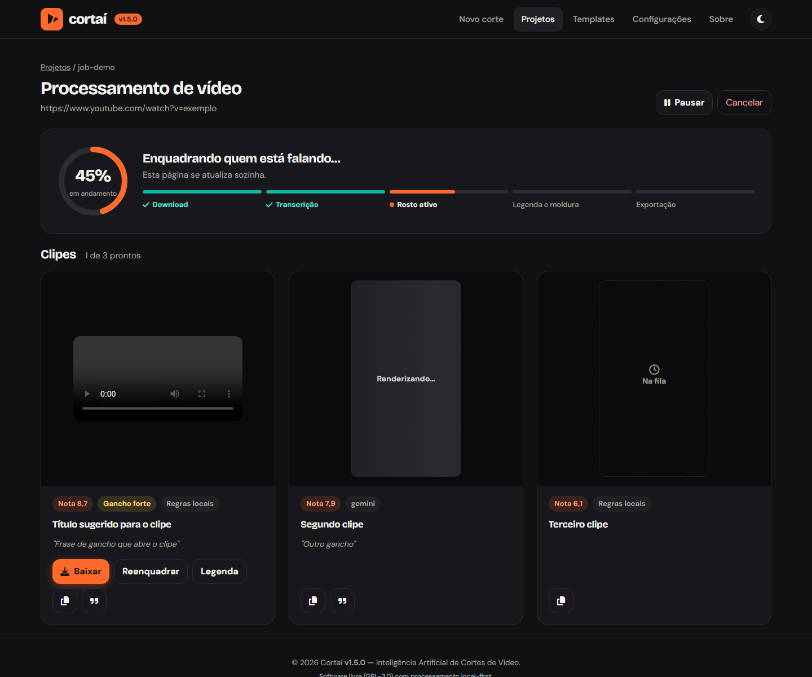

<p align="center">
  
</p>

# ✂️ Cortaí v1.6.0

O Cortaí transforma vídeos longos em cortes verticais (9:16) e horizontais (16:9) legendados, prontos para Shorts, TikTok e Reels. Tudo roda no seu computador.

<p align="center">
  <a href="docs/screenshots/novo-corte.png"></a>
  <a href="docs/screenshots/processando.png"></a>
</p>


## Comece em 3 passos

1. Instale o [Python 3.12 ou mais recente](https://www.python.org/downloads/) e o [FFmpeg](#pré-requisitos) (com `ffprobe`).
2. Baixe o projeto e rode o inicializador:
   - **Windows**: dê duplo clique em `start.bat`.
   - **Linux/macOS**: rode `./start.sh` no terminal.
3. No Windows, o Cortaí abre numa janela própria. No Linux e no macOS, abra **http://127.0.0.1:5000** no navegador.

O inicializador cria o ambiente virtual, instala as dependências e inicia o servidor. Nas próximas vezes, rode o mesmo arquivo para abrir o Cortaí.

**No Windows sem instalar o Python:** baixe o `Cortai.exe` na página de [Releases](https://github.com/julianleno/cortai/releases) e dê duplo clique. Ele precisa do FFmpeg instalado e abre numa janela própria, sem navegador.

---

## Funcionalidades

- **Vídeos em lote**: cole até 10 links do YouTube (um por linha) ou envie vários arquivos `.mp4`, `.mkv`, `.mov`, `.avi` e `.webm`. Cada vídeo vira um projeto, e a tela **Projetos** mostra o andamento de todos.
- **Seleção dos melhores momentos**: com uma chave de IA (Gemini, OpenAI, Anthropic ou NVIDIA NIM), a IA escolhe os trechos. Sem chave, um motor local escolhe e categoriza os trechos, sem enviar nada para a nuvem. Cada clipe recebe nota, título e gancho, que você copia com um clique.
- **Formatos**: vertical 9:16 (até 60 s) para Shorts, TikTok e Reels, ou horizontal 16:9 (até 5 min) para cortes de podcast. Escolha de 1 a 10 clipes por vídeo e a duração mínima e máxima.
- **Enquadramento**: *Segue o rosto* (centraliza quem fala), *Ativo por fala* (troca de rosto pelo movimento dos lábios e pelo áudio, com OpenCV YuNet), *Card social*, *Editorial* (título no topo e marca embaixo), *Fundo desfocado* e *Crop central*.
- **Reenquadrar**: mova o corte 9:16 para a esquerda ou para a direita com um controle deslizante e gere o clipe de novo, sem reprocessar o vídeo inteiro.
- **Legendas**: 6 estilos (Karaoke Destaque, Branco Bold, Amarelo Bold, Branco + Amarelo, Destaque Vermelho e Ciano com Sombra), 9 fontes e capitalização em CAIXA-ALTA ou título gramatical (conectivos como `de`, `da`, `e`, `para` ficam em minúsculas). Vídeos sem fala recebem uma legenda fixa.
- **Vocabulário**: informe nomes e siglas (ex.: `ANAC`, `VOEPASS`) para a legenda corrigir o que o Whisper errar. Há atalhos de um clique para termos comuns.
- **Editor de legenda**: corrija palavra por palavra e troque a fonte de um clipe pronto; o Cortaí gera o clipe de novo.
- **Templates**: salve enquadramento, estilo e fonte da legenda, capitalização, marca d'água (posição e opacidade) e vocabulário para usar em outros vídeos.
- **Controle do processamento**: progresso em 5 etapas (Download, Transcrição, Rosto ativo, Legenda e moldura, Exportação), com **Pausar**, **Retomar** e **Cancelar**. Projetos cancelados continuam no histórico até você excluí-los. Se o servidor reiniciar no meio de um processamento, o projeto fica marcado como interrompido.
- **Prévia e download**: assista a cada clipe no navegador antes de baixar.
- **Idioma da fala**: detecção automática, ou escolha português, inglês ou espanhol.
- **YouTube com verificação anti-robô**: na tela **Configurações**, escolha de qual navegador o Cortaí usa os cookies quando o YouTube pede login.

A identidade visual (marca, paleta e tipografia) está em [`docs/brand/`](docs/brand/).

---

## Índice

- [Pré-requisitos](#pré-requisitos)
- [Instalação](#instalação)
- [Como usar](#como-usar)
- [Chaves de IA e variáveis de ambiente](#chaves-de-ia-e-variáveis-de-ambiente)
- [Desenvolvimento e testes](#desenvolvimento-e-testes)
- [Estrutura do projeto](#estrutura-do-projeto)
- [Histórico de versões](#histórico-de-versões)
- [Contribuindo](#contribuindo)
- [Licença](#licença)

---

## Pré-requisitos

| Requisito | Para que serve | Como instalar |
|---|---|---|
| **Python 3.12+** | Executa a aplicação | **Windows**: [python.org](https://www.python.org/downloads/) (marque "Add python.exe to PATH"). **Ubuntu/Debian**: `sudo apt install python3 python3-venv`. **macOS**: `brew install python@3.12` |
| **FFmpeg** (com `ffprobe`) | Processa vídeo e áudio | **Windows**: baixe o build "full" em [gyan.dev/ffmpeg/builds](https://www.gyan.dev/ffmpeg/builds/) e adicione a pasta `bin` ao PATH. **Ubuntu/Debian**: `sudo apt install ffmpeg`. **macOS**: `brew install ffmpeg` |

Para conferir se está tudo pronto, rode no terminal:

```bash
python --version     # Linux/macOS: python3 --version
ffmpeg -version
ffprobe -version
```

O [uv](https://docs.astral.sh/uv/) é opcional. Se ele estiver instalado, os inicializadores usam o uv para criar o ambiente e instalar as dependências mais rápido.

---

## Instalação

### Windows

1. Clone o repositório:
   ```powershell
   git clone https://github.com/julianleno/cortai.git
   cd cortai
   ```
2. Dê duplo clique em **`start.bat`** ou rode no PowerShell:
   ```powershell
   powershell -ExecutionPolicy Bypass -File start.ps1
   ```
3. Abra **http://127.0.0.1:5000** no navegador.

### Linux e macOS

1. Clone o repositório e rode o inicializador:
   ```bash
   git clone https://github.com/julianleno/cortai.git
   cd cortai
   ./start.sh
   ```
2. Abra **http://127.0.0.1:5000** no navegador.

Se aparecer `Permission denied`, rode `bash start.sh`.

### O que os inicializadores fazem

`start.bat`/`start.ps1` (Windows) e `start.sh` (Linux/macOS) seguem os mesmos passos:

1. Conferem o Python, o FFmpeg e o ffprobe, e mostram como instalar o que faltar.
2. Copiam `.env.example` para `.env`, se o `.env` não existir.
3. Criam o ambiente virtual `.venv` e instalam o Cortaí nele.
4. Criam as pastas `storage/downloads`, `storage/output` e `storage/temp`.
5. Leem `FLASK_PORT` do `.env` (padrão `5000`) e avisam se a porta estiver ocupada.
6. Iniciam o servidor. Para encerrar, pressione `CTRL+C`.

### Instalação manual (alternativa)

Para instalar sem o inicializador no Linux ou no macOS:

```bash
git clone https://github.com/julianleno/cortai.git
cd cortai
cp .env.example .env
python3 -m venv .venv
source .venv/bin/activate
pip install -e .
python -m cortai.app
```

Depois, abra **http://127.0.0.1:5000** no navegador.

---

## Como usar

1. **Escolha os vídeos**: cole um ou mais links do YouTube, ou abra a aba **Arquivos do computador** e selecione um ou mais vídeos.
2. **Escolha o formato**: **Vertical 9:16** (até 60 s) ou **Horizontal 16:9** (até 5 min).
3. **Escolha o enquadramento**: por exemplo, **Segue o rosto** ou **Ativo por fala**.
4. **Escolha a legenda**: estilo, fonte e capitalização.
5. **Ajustes avançados** (opcional): quantidade de clipes (1 a 10), duração mínima e máxima, idioma da fala, vocabulário e template.
6. Clique em **Gerar cortes**. Acompanhe as etapas e use **Pausar**, **Retomar** ou **Cancelar** se precisar.
7. Assista aos clipes na página do projeto. Use **Reenquadrar** para mover o corte, **Legenda** para corrigir palavras e **Baixar** para salvar o clipe.

---

## Chaves de IA e variáveis de ambiente

### Chaves de IA (opcionais)

Sem nenhuma chave, o Cortaí funciona **100% local**, com o motor próprio de seleção e categorização de trechos.

Com uma chave, a IA escolhe os melhores trechos. Configure as chaves de um destes jeitos:

- Na tela **Configurações** do app (`/settings`). As chaves salvas ali têm prioridade sobre o `.env`.
- No arquivo `.env`, com as variáveis abaixo.

| Provedor | Chave | Modelo padrão |
|---|---|---|
| Google Gemini | `GEMINI_API_KEY` | `gemini-flash-latest` (mude com `GEMINI_MODEL`) |
| OpenAI | `OPENAI_API_KEY` | `gpt-4o-mini` |
| Anthropic | `ANTHROPIC_API_KEY` | `claude-3-5-haiku-20241022` |
| NVIDIA NIM | `NVIDIA_NIM_API_KEY` | `meta/llama-3.1-8b-instruct` (mude com `NVIDIA_NIM_MODEL`) |

Se houver mais de uma chave, o Cortaí tenta os provedores nesta ordem: Gemini, OpenAI, Anthropic e NVIDIA NIM. Se todos falharem, ele usa o motor local.

### Outras variáveis

O inicializador cria o `.env` a partir do `.env.example`. Para criar à mão:

```bash
cp .env.example .env        # Windows: copy .env.example .env
```

| Variável | Padrão | Para que serve |
|---|---|---|
| `FLASK_HOST` / `FLASK_PORT` | `127.0.0.1` / `5000` | Endereço do servidor local. Mantenha `127.0.0.1` para não expor o app na rede. |
| `FLASK_DEBUG` | `False` | Modo de depuração do Flask. Deixe `False` no uso normal. |
| `WHISPER_MODEL_SIZE` | `base` | Modelo do faster-whisper (`tiny`, `base`, `small`, `medium`, `large-v3`). |
| `WHISPER_DEVICE` / `WHISPER_COMPUTE_TYPE` | `cpu` / `int8` | Use `cuda` / `float16` se tiver GPU NVIDIA. |
| `FFMPEG_THREADS` | `0` | Threads do FFmpeg. `0` deixa o FFmpeg decidir. |
| `YTDLP_FORMAT` / `YTDLP_OUTDIR` | MP4 / `./storage/downloads` | Formato e pasta dos downloads do YouTube. |
| `OUTPUT_DIR` / `TEMP_DIR` / `DB_PATH` | `./storage/...` | Onde ficam os clipes, os arquivos temporários e o banco SQLite. |
| `WATERMARK_IMAGE` | `./assets/watermark.png` | Imagem padrão da marca d'água dos templates. |

---

## Desenvolvimento e testes

O pytest não faz parte das dependências principais: ele está em `[tool.uv] dev-dependencies` no `pyproject.toml`. Instale-o no ambiente virtual e rode a suíte:

```bash
# Linux/macOS
.venv/bin/pip install pytest
.venv/bin/python -m pytest tests/ -v
```

```powershell
# Windows
.venv\Scripts\python -m pip install pytest
.venv\Scripts\python -m pytest tests/ -v
```

Com o uv, use `uv pip install pytest --python .venv` no lugar do `pip install`.

Quer contribuir? Leia o **[guia de contribuição](CONTRIBUTING.md)**.

---

## Estrutura do projeto

```
cortai/
├── src/cortai/
│   ├── app.py               # Servidor Flask, rotas de lote, crop e controle de jobs
│   ├── core.py              # Renderização de vídeo, recortes 9:16/16:9 e molduras
│   ├── db.py                # Persistência SQLite, jobs interrompidos e exclusão
│   ├── face_tracking.py     # Lip-Sync e detecção de rosto (YuNet/ONNX)
│   ├── subtitles.py         # Presets visuais de legenda (.ass) e casing TitleCase
│   ├── templates.py         # Validação e gerenciamento de templates
│   ├── clip_selection.py    # Seleção automática de clipes (Gemini / NIM / OpenAI / Anthropic / Local)
│   ├── transcription.py     # Transcrição local faster-whisper com cache
│   ├── providers/           # Integrações com provedores de IA
│   ├── models/              # Modelo YuNet (ONNX) de detecção de rosto
│   └── templates/           # Interface HTML5 (novo corte, status, projetos, configurações)
├── tests/                   # Testes unitários e de integração (pytest)
├── docs/                    # Identidade visual e screenshots
├── DECISIONS.md             # Registros de Decisão de Arquitetura (ADRs)
├── CONTRIBUTING.md          # Como contribuir
├── LICENSE                  # Licença GPL-3.0
├── pyproject.toml           # Configuração do pacote e versão
├── start.bat / start.ps1    # Inicialização rápida no Windows
└── start.sh                 # Inicialização rápida no Linux e no macOS
```

---

## Histórico de versões

- **v1.6.0 (Atual)**:
  - Visual novo em todas as telas, com cartões de enquadramento e prévia de legenda.
  - `start.sh` para Linux e macOS e executável Windows (`Cortai.exe`) nas releases.
  - Corrige a transcrição em instalações novas (PyAV 19) e atualiza o modelo padrão da Anthropic.
  - CI com testes a cada mudança.
- **v1.5.0**:
  - Processamento em lote (Multi-URL e multi-arquivo).
  - Nova identidade visual Cortaí (marca, paleta Caju/Mar/Sol e tipografia).
  - Tela de carregamento com barra de progresso contínua.
  - Ferramenta de Correção de Texto & Dicionário IA Integrada.
  - Controle de Jobs (Pausar, Retomar e Cancelar).
  - Player de prévia de vídeo HTML5 embutido.
  - Ferramenta de ajuste lateral de enquadramento 9:16.
  - Suporte a formato horizontal (16:9 até 5 min).
  - Active Speaker Lip-Sync e molduras sociais/editoriais.
  - Capitalização `TitleCase` mantendo conectivos em minúsculas.
- **v1.0.0**: Lançamento inicial local-first com suporte a YouTube 9:16 e Faster-Whisper.

---

## Contribuindo

Contribuições são muito bem-vindas! Leia o [CONTRIBUTING.md](CONTRIBUTING.md) e o [Código de Conduta](CODE_OF_CONDUCT.md) antes de abrir uma issue ou um pull request. Para relatar falhas de segurança, siga o [SECURITY.md](SECURITY.md).

---

## Uso responsável

O Cortaí é uma ferramenta de edição. Você é responsável pelo conteúdo que processa: use apenas vídeos que você tem direito de baixar, editar e publicar, e respeite os direitos autorais e os Termos de Serviço das plataformas (incluindo o YouTube).

---

## Créditos

O Cortaí é construído sobre projetos open source incríveis:

- [FFmpeg](https://ffmpeg.org/): processamento de vídeo e áudio
- [faster-whisper](https://github.com/SYSTRAN/faster-whisper): transcrição local
- [yt-dlp](https://github.com/yt-dlp/yt-dlp): download de vídeos
- [OpenCV](https://opencv.org/) e o modelo [YuNet](https://github.com/opencv/opencv_zoo/tree/main/models/face_detection_yunet) (licença MIT): detecção de rosto
- [Flask](https://flask.palletsprojects.com/): interface web

---

## Licença

Distribuído sob a licença **GNU General Public License v3.0**. Veja o arquivo [LICENSE](LICENSE) para mais detalhes.

Em resumo: você pode usar, estudar, modificar e redistribuir o Cortaí, inclusive comercialmente, desde que versões modificadas distribuídas também sejam abertas sob a GPL-3.0.

---

© 2026 Julian Leno e colaboradores do Cortaí.
