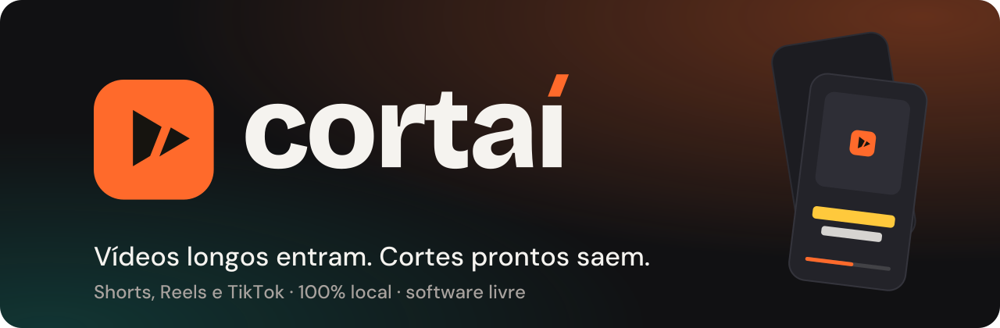

<p align="center">
  
</p>

# ✂️ Cortaí v1.5.0

Aplicação **local-first** de alta performance que transforma vídeos longos (do YouTube ou arquivos locais do seu computador) em clipes virais e profissionais — nos formatos **Vertical (9:16)** e **Horizontal (16:9)** — prontos para **YouTube Shorts, TikTok, Instagram Reels e Redes Sociais**.

Com seleção automática dos melhores momentos via IA, reenquadramento inteligente por detecção de rosto e movimento labial (**Active Speaker Lip-Sync**), legendas estilizadas acentuadas, tratamento de gramática (`TitleCase`), molduras sociais/editoriais e ferramentas visuais de ajuste.

> **Uma ou várias URLs entram. Clipes em HD, legendados, recortados e personalizados saem.**

---


---

## 🚀 Principais Funcionalidades da v1.5.0

### 📦 1. Processamento em Lote (Multi-URL & Múltiplos Arquivos)
- **YouTube Multi-URL**: Cole até 10 URLs do YouTube simultaneamente no formulário inicial (uma por linha).
- **Upload Local de Múltiplos Arquivos**: Suporte nativo para envio simultâneo de vídeos `.mp4`, `.mkv`, `.mov`, `.avi` e `.webm`.
- **Painel de Projetos / Lotes (`/projects`)**: Acompanhe o progresso de múltiplos projetos em paralelo com estatísticas, ETAs e cartões organizados.

### 🎨 2. Identidade Visual Cortaí
- **Marca "play cortado"**: um botão de play fatiado na diagonal, o corte que dá nome ao projeto. O acento do "í" no logotipo segue o mesmo ângulo.
- **Paleta**: *Caju* (`#FF6A2B`) como cor principal, *Mar* (`#12B5A6`) e *Sol* (`#FFC93C`) como destaques, sobre fundo *Noite* (`#111113`) ou *Areia* (`#FBF7F2`) no tema claro.
- **Tipografia**: *Bricolage Grotesque* nos títulos e no logotipo, *DM Sans* no restante da interface.
- Guia completo e arquivos do logo em [`docs/brand/`](docs/brand/).

### 🔍 3. Ferramenta de Correção de Texto & Dicionário IA Integrada
- **Correção Automática de Transcrição**: Substitui instantaneamente siglas, marcas e termos falados que o Whisper possa ter grafado errado (ex: corrigindo `"ANAK"` para `"ANAC"`, `"voepas"` para `"VOEPASS"`).
- **Chips de Atalho com 1 Clique**: Pré-carregados com marcas e termos comuns (`ANAC`, `VOEPASS`, `Cortaí`, `IA`, `YouTube`, `ChatGPT`), além de campo para adicionar termos personalizados.

### ⏱️ 4. Progresso Dinâmico Contínuo
- **Indicador Circular Animado**: Medidor visual fluido que avança continuamente em tempo real sem saltos ou travamentos.
- **5 Etapas do Pipeline**:
  1. 📥 `1. Download Mídia`
  2. 🎙️ `2. Transcrição IA`
  3. 👤 `3. Lip-Sync & Rosto Ativo`
  4. 🎨 `4. Legenda & Moldura`
  5. 🎬 `5. Exportação Clipes`

### ⏸️ 5. Controle Total de Execução (Pausar, Retomar, Cancelar)
- **Controle Operacional**: Botões em tempo real para **Pausar**, **Retomar** e **Cancelar** qualquer processamento.
- **Remoção Imediata de Cancelados**: Projetos cancelados são totalmente purgados do banco de dados e da tela sem deixar registros.
- **Purga de Processos Órfãos**: Limpeza automática de tarefas inacabadas ao iniciar o servidor, mantendo a execução 100% limpa.

### ▶️ 6. Player de Prévia HTML5 Embutido
- Assista aos clipes em alta definição **diretamente no navegador** através do player HTML5 embutido no card antes de realizar o download.

### ✂️ 7. Ajustador Lateral de Enquadramento 9:16
- Modal interativo com visualização da moldura 9:16 e slider horizontal ($0\%$ a $100\%$) para re-enquadrar manualmente a cena no ponto desejado e re-renderizar sem reprocessar o vídeo inteiro.

### 📐 8. Proporções Personalizadas & Limites de Duração
- **Vertical (9:16)**: Até 60 segundos (1 minuto) ideal para Shorts, TikTok e Reels.
- **Horizontal (16:9)**: Até 300 segundos (5 minutos) perfeito para cortes de podcasts e vídeos longos.

### 👤 9. Detecção de Rosto & Active Speaker Lip-Sync
- **Segue o Rosto**: Enquadramento inteligente centralizado na cabeça do falante.
- **Ativo por Fala (Lip-Sync)**: Analisa variância de movimento labial (OpenCV YuNet/ONNX) e histogramas de áudio para trocar o enquadramento dinamicamente quando a conversa muda de interlocutor.

### 💬 10. Legendas Estilizadas & Regras de Gramática
- **6 Presets Visuais**: *Branco caixa-alta*, *Amarelo forte*, *Palavra-chave em amarelo*, *Expressão destacada*, *Ciano com sombra* e *Destaque progressivo Karaokê*.
- **Capitalização Inteligente (`TitleCase`)**: Mantém conectivos e preposições (`o`, `a`, `de`, `do`, `da`, `e`, `em`, `por`, `com`, `para`, `sem`, `sob`, `sobre`) em minúsculas conforme regras gramaticais.
- **Vídeos Sem Fala**: Gera automaticamente legendas estáticas de capa para vídeos sem áudio falado.

### 🖼️ 11. Molduras Sociais & Editoriais
- **Moldura Social Card (`card_frame`)**: Estilo Twitter/Instagram com card flutuante.
- **Moldura Editorial (`header_footer_frame`)**: Topo com título do canal e rodapé de marca.

---

## 📑 Índice

- [Pré-requisitos](#-pré-requisitos)
- [Instalação](#-instalação)
- [Como Usar](#-como-usar)
- [Variáveis de Ambiente](#-variáveis-de-ambiente)
- [Desenvolvimento & Testes](#️-desenvolvimento--testes)
- [Estrutura do Projeto](#-estrutura-do-projeto)
- [Histórico de Versões](#️-histórico-de-versões)
- [Contribuindo](#-contribuindo)
- [Licença](#-licença)

---

## 💻 Pré-requisitos

| Requisito | Descrição | Onde Obter |
|---|---|---|
| **Windows 10 / 11** *(recomendado)* | Os scripts `start.bat`/`start.ps1` automatizam a instalação no Windows. No **Linux/macOS** a instalação é manual (veja abaixo) | — |
| **Python 3.12+** | Executa a aplicação e módulos de IA | [python.org](https://www.python.org/downloads/) *(Marque "Add Python to PATH")* |
| **FFmpeg** (com `ffprobe`) | Responsável pelo processamento de vídeo e áudio | Baixe o build full em [gyan.dev/ffmpeg/builds](https://www.gyan.dev/ffmpeg/builds/) e adicione a pasta `bin` ao PATH. No Linux: `sudo apt install ffmpeg`; no macOS: `brew install ffmpeg` |

Verifique no terminal se o ambiente está pronto:
```powershell
python --version
ffmpeg -version
ffprobe -version
```

**Opcional para baixar do YouTube:** instale o [Deno](https://deno.com/) e deixe
o executável no PATH. O yt-dlp habilita o Deno por padrão. Sem um runtime
JavaScript compatível, o download ainda pode funcionar, mas alguns formatos
podem ficar indisponíveis.

- No Windows: `winget install DenoLand.Deno`
- No macOS: `brew install deno`

Abra um novo terminal e execute `deno --version` para conferir a instalação.
Se o aviso persistir ou ainda faltarem formatos, consulte o
[guia de configuração EJS do yt-dlp](https://github.com/yt-dlp/yt-dlp/wiki/EJS).

---

## 📥 Instalação

### Windows (inicializador automático)

1. **Clone o repositório**:
   ```powershell
   git clone https://github.com/julianleno/cortai.git
   cd cortai
   ```
2. **Execute o inicializador automático**:
   Dê duplo clique no arquivo **`start.bat`** ou rode via PowerShell:
   ```powershell
   powershell -ExecutionPolicy Bypass -File start.ps1
   ```
3. O script criará o ambiente virtual `.venv`, instalará todas as dependências e iniciará o servidor local na porta `5000`.
4. Abra o seu navegador em **`http://127.0.0.1:5000`**.

### Linux / macOS (instalação manual)

```bash
git clone https://github.com/julianleno/cortai.git
cd cortai
python3 -m venv .venv
source .venv/bin/activate
pip install -e .
python -m cortai.app
```

Depois, abra **http://127.0.0.1:5000** no navegador.

---

## 🎯 Como Usar

1. **Selecione a Fonte de Entrada**:
   - Para vídeos do YouTube, cole uma ou mais URLs na caixa de texto.
   - Para vídeos locais, clique na aba "Arquivo Local" e selecione um ou múltiplos vídeos.
2. **Configure o Formato & Duração**:
   - Escolha entre **Vertical 9:16 (até 1 min)** ou **Horizontal 16:9 (até 5 min)**.
   - Defina a quantidade de clipes desejada (1 a 10).
3. **Ajuste o Estilo Visual & Legendas**:
   - Selecione um dos 6 estilos visuais de legenda.
   - Escolha o modo de capitalização (**UPPERCASE** ou **TitleCase**).
   - Ative termos no **Dicionário IA Integrado** para correção de nomes próprios.
4. **Inicie o Processamento**:
   - Acompanhe o progresso dinâmico por etapas ou use os botões **Pausar**, **Retomar** ou **Cancelar**.
5. **Prévia & Download**:
   - Assista aos vídeos no player HTML5 embutido, ajuste o enquadramento lateral com o botão **Ajustar Crop** se desejar, e baixe o clipe pronto em HD.

---

## 🔑 Variáveis de Ambiente

Copie o arquivo de exemplo e ajuste o que precisar:

```bash
cp .env.example .env        # Windows: copy .env.example .env
```

| Variável | Padrão | Para que serve |
|---|---|---|
| `FLASK_HOST` / `FLASK_PORT` | `127.0.0.1` / `5000` | Endereço do servidor local. Mantenha `127.0.0.1` para não expor o app na rede. |
| `WHISPER_MODEL_SIZE` | `base` | Modelo do faster-whisper (`tiny`, `base`, `small`, `medium`, `large-v3`). |
| `WHISPER_DEVICE` / `WHISPER_COMPUTE_TYPE` | `cpu` / `int8` | Use `cuda` / `float16` se tiver GPU NVIDIA. |
| `OUTPUT_DIR` / `TEMP_DIR` / `DB_PATH` | `./storage/...` | Onde ficam os clipes, arquivos temporários e o banco SQLite. |
| `GEMINI_API_KEY`, `NVIDIA_NIM_API_KEY`, `OPENAI_API_KEY`, `ANTHROPIC_API_KEY` | *(vazio)* | **Opcionais.** Ativam a seleção de clipes por IA na nuvem. Também podem ser configuradas na tela **/settings**. |

> Sem nenhuma chave de API, o Cortaí funciona **100% local**, com o motor próprio de seleção e categorização de trechos.

---

## 🛠️ Desenvolvimento & Testes

Instale as dependências de desenvolvimento e rode a suíte de testes:

```bash
pip install -e . pytest black flake8 mypy
python -m pytest tests/ -v
```

No Windows, com o ambiente criado pelo `start.ps1`:

```powershell
.venv\Scripts\python -m pytest tests/ -v
```

Quer contribuir? Leia o **[guia de contribuição](CONTRIBUTING.md)**.

---

## 📁 Estrutura do Projeto

```
cortai/
├── src/cortai/
│   ├── app.py               # Servidor Flask, rotas de lote, crop e controle de jobs
│   ├── core.py              # Renderização de vídeo, recortes 9:16/16:9 e molduras
│   ├── db.py                # Persistência SQLite, purga de órfãos e exclusão
│   ├── face_tracking.py     # Lip-Sync e detecção de rosto (YuNet/ONNX)
│   ├── subtitles.py         # Presets visuais de legenda (.ass) e casing TitleCase
│   ├── templates.py         # Validação e gerenciamento de templates
│   ├── clip_selection.py    # Seleção automática de clipes (Gemini / NIM / OpenAI / Anthropic / Local)
│   ├── transcription.py     # Transcrição local faster-whisper com cache
│   ├── providers/           # Integrações com provedores de IA
│   ├── models/              # Modelo YuNet (ONNX) de detecção de rosto
│   └── templates/           # Interface HTML5 (dashboard, status, projetos, settings)
├── tests/                   # Testes unitários e de integração (pytest)
├── DECISIONS.md             # Registros de Decisão de Arquitetura (ADRs)
├── CONTRIBUTING.md          # Como contribuir
├── LICENSE                  # Licença GPL-3.0
├── pyproject.toml           # Configuração do pacote e versão
└── start.bat / start.ps1    # Inicialização rápida no Windows
```

---

## 🏷️ Histórico de Versões

- **v1.5.0 (Atual)**:
  - Processamento em lote (Multi-URL e multi-arquivo).
  - Nova identidade visual Cortaí (marca, paleta Caju/Mar/Sol e tipografia).
  - Tela de carregamento com barra de progresso contínua.
  - Ferramenta de Correção de Texto & Dicionário IA Integrada.
  - Controle de Jobs (Pausar, Retomar, Cancelar com remoção instantânea).
  - Player de prévia de vídeo HTML5 embutido.
  - Ferramenta de ajuste lateral de enquadramento 9:16.
  - Suporte a formato horizontal (16:9 até 5 min).
  - Active Speaker Lip-Sync e molduras sociais/editoriais.
  - Capitalização `TitleCase` mantendo conectivos em minúsculas.
- **v1.0.0**: Lançamento inicial local-first com suporte a YouTube 9:16 e Faster-Whisper.

---

## 🤝 Contribuindo

Contribuições são muito bem-vindas! Leia o [CONTRIBUTING.md](CONTRIBUTING.md) e o [Código de Conduta](CODE_OF_CONDUCT.md) antes de abrir uma issue ou um pull request. Para relatar falhas de segurança, siga o [SECURITY.md](SECURITY.md).

---

## ⚖️ Uso Responsável

O Cortaí é uma ferramenta de edição. Você é responsável pelo conteúdo que processa: use apenas vídeos que você tem direito de baixar, editar e publicar, e respeite os direitos autorais e os Termos de Serviço das plataformas (incluindo o YouTube).

---

## 🙏 Créditos

O Cortaí é construído sobre projetos open source incríveis:

- [FFmpeg](https://ffmpeg.org/): processamento de vídeo e áudio
- [faster-whisper](https://github.com/SYSTRAN/faster-whisper): transcrição local
- [yt-dlp](https://github.com/yt-dlp/yt-dlp): download de vídeos
- [OpenCV](https://opencv.org/) e o modelo [YuNet](https://github.com/opencv/opencv_zoo/tree/main/models/face_detection_yunet) (licença MIT): detecção de rosto
- [Flask](https://flask.palletsprojects.com/): interface web

---

## 📄 Licença

Distribuído sob a licença **GNU General Public License v3.0**. Veja o arquivo [LICENSE](LICENSE) para mais detalhes.

Em resumo: você pode usar, estudar, modificar e redistribuir o Cortaí, inclusive comercialmente, desde que versões modificadas distribuídas também sejam abertas sob a GPL-3.0.

---

© 2026 Julian Leno e colaboradores do Cortaí.
